# 3D Website Factory

**Real 3D websites from a folder of content, or your existing website made 3D.**
An agent skill for Claude Code, Cursor, Codex, Antigravity, Hermes and other coding agents.

[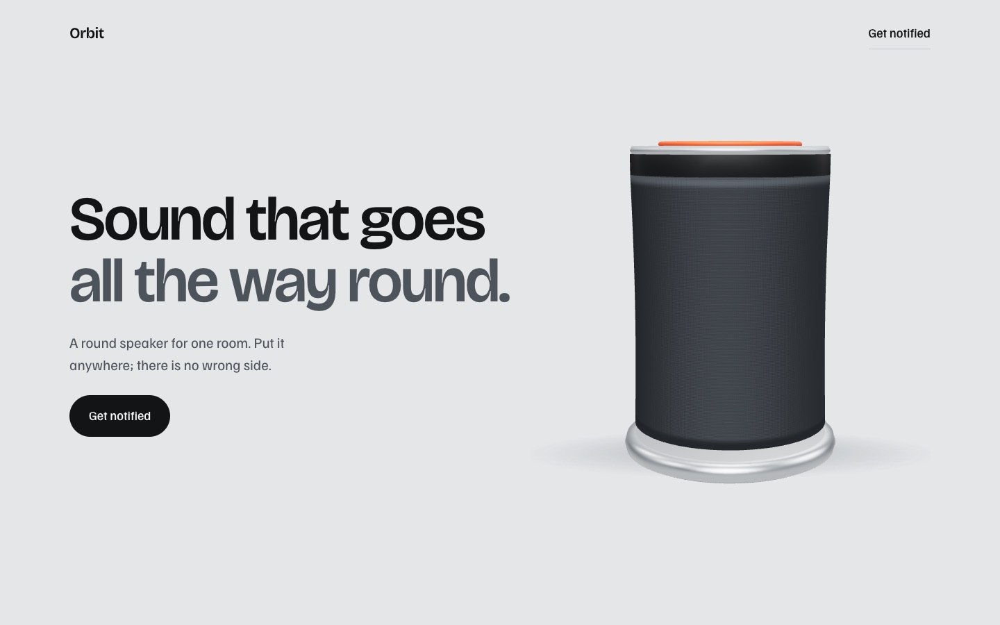](https://bibeksarkar001.github.io/3d-website-factory/orbit/)

| | |
|---|---|
| [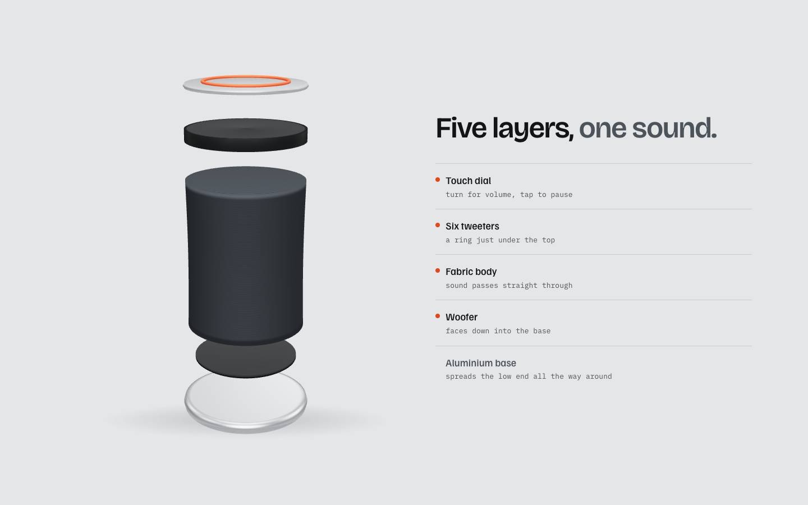](https://bibeksarkar001.github.io/3d-website-factory/orbit/) | [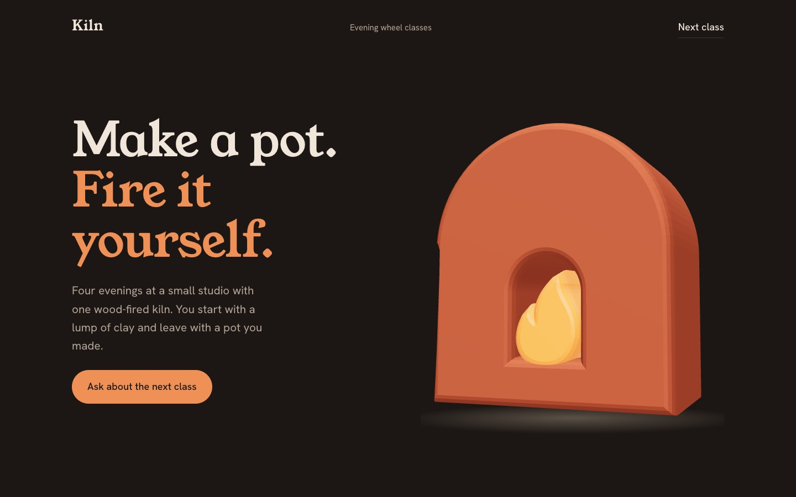](https://bibeksarkar001.github.io/3d-website-factory/kiln/) |
| **Orbit.** A speaker built from code. It tilts to your cursor, opens into five labelled layers as you scroll, and its dial turns on the page. [Live demo →](https://bibeksarkar001.github.io/3d-website-factory/orbit/) | **Kiln.** A flat SVG logo made into a fired-clay object with a glowing flame. It follows the cursor and turns as you scroll. [Live demo →](https://bibeksarkar001.github.io/3d-website-factory/kiln/) |

| [](https://bibeksarkar001.github.io/3d-website-factory/guild/) | [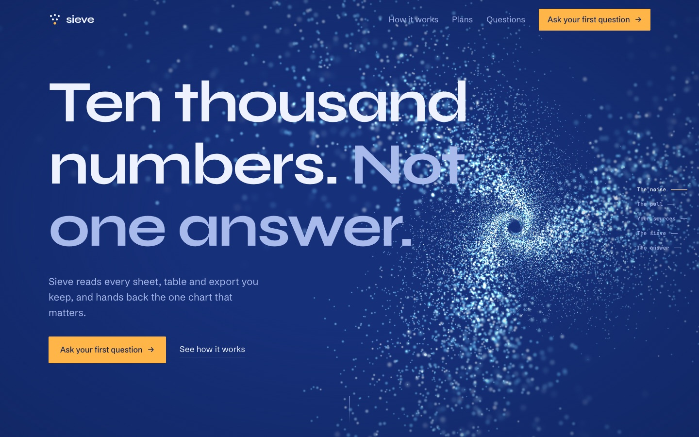](https://bibeksarkar001.github.io/3d-website-factory/sieve/) |
| **Guild.** A community site styled as an annual report. A dot globe turns as you scroll and member dots glow in. [Live demo →](https://bibeksarkar001.github.io/3d-website-factory/guild/) | **Sieve.** A data tool. You scroll through a vortex of light particles until they settle into one bar chart. [Live demo →](https://bibeksarkar001.github.io/3d-website-factory/sieve/) |

| [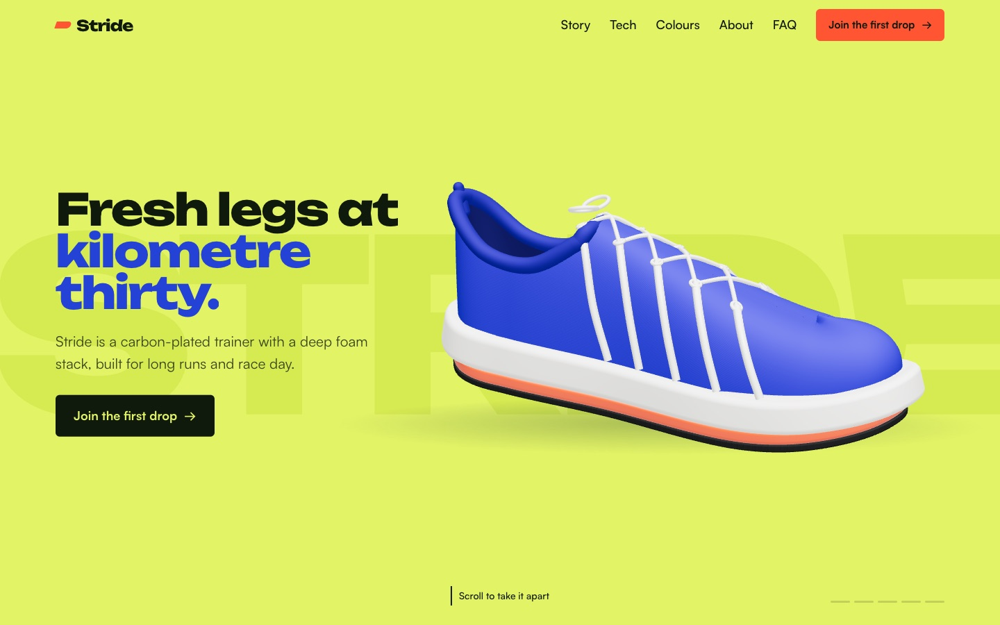](https://bibeksarkar001.github.io/3d-website-factory/stride/) | [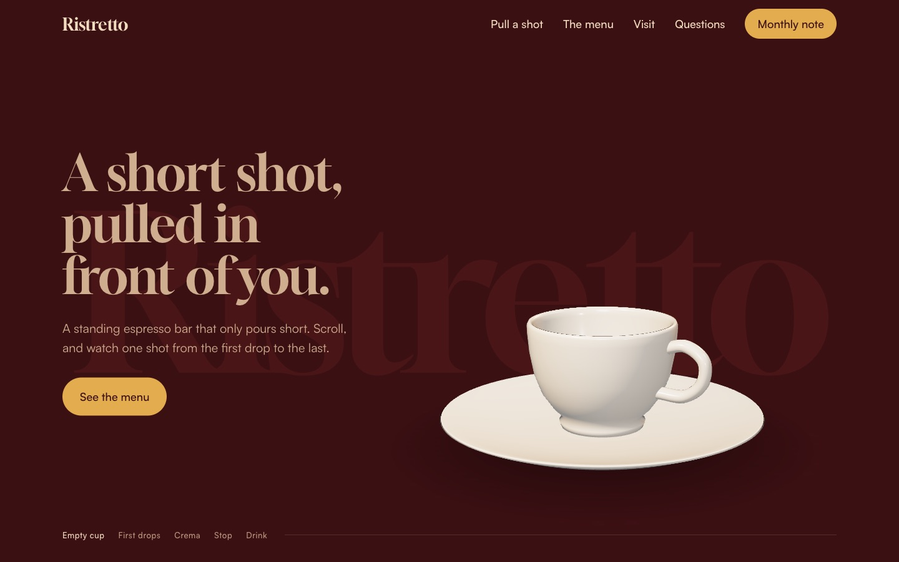](https://bibeksarkar001.github.io/3d-website-factory/ristretto/) |
| **Stride.** A running shoe that comes apart into its six layers as you scroll. [Live demo →](https://bibeksarkar001.github.io/3d-website-factory/stride/) | **Ristretto.** An espresso bar. One shot pours into the cup as you scroll. [Live demo →](https://bibeksarkar001.github.io/3d-website-factory/ristretto/) |
| [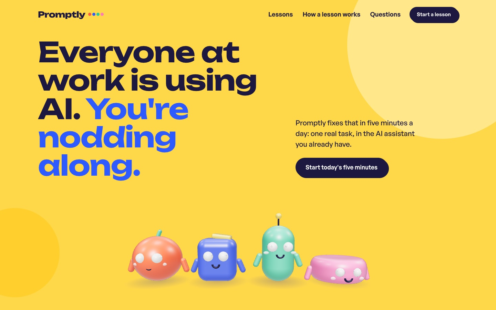](https://bibeksarkar001.github.io/3d-website-factory/promptly/) | [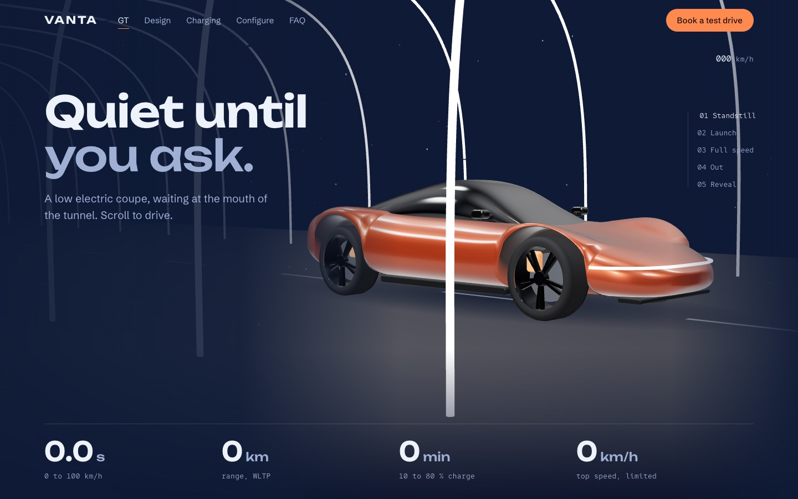](https://bibeksarkar001.github.io/3d-website-factory/vanta/) |
| **Promptly.** Four 3D coaches whose eyes follow you, hop as your streak grows, and cheer when you sign up. [Live demo →](https://bibeksarkar001.github.io/3d-website-factory/promptly/) | **Vanta.** An electric coupe that drives through a tunnel of light as you scroll, then lets you pick its paint and wheels. [Live demo →](https://bibeksarkar001.github.io/3d-website-factory/vanta/) |
| [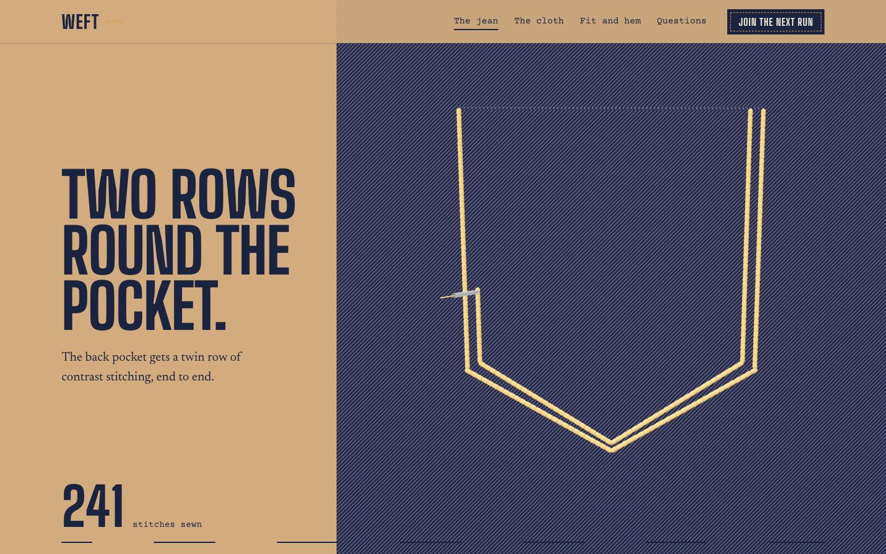](https://bibeksarkar001.github.io/3d-website-factory/weft/) | [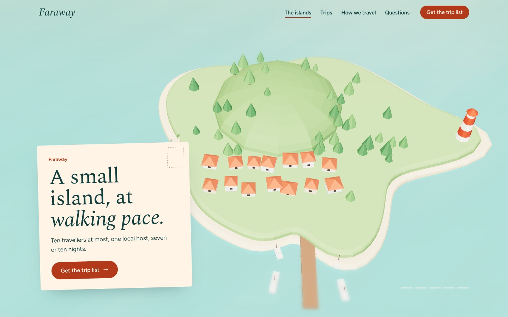](https://bibeksarkar001.github.io/3d-website-factory/faraway/) |
| **Weft.** Selvedge denim. Scroll and a needle sews the pocket, sets the rivets and hems the leg. [Live demo →](https://bibeksarkar001.github.io/3d-website-factory/weft/) | **Faraway.** Small-group travel. Fly over a miniature island as the day turns to dusk and the lighthouse comes on. [Live demo →](https://bibeksarkar001.github.io/3d-website-factory/faraway/) |
| [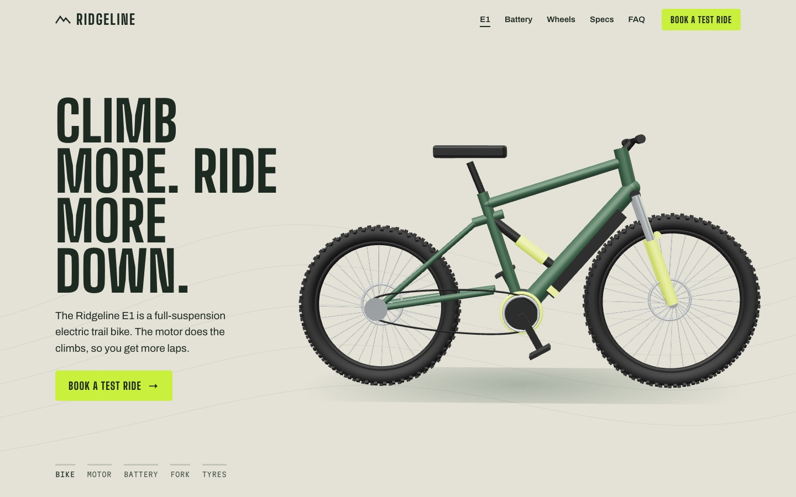](https://bibeksarkar001.github.io/3d-website-factory/ridgeline/) | [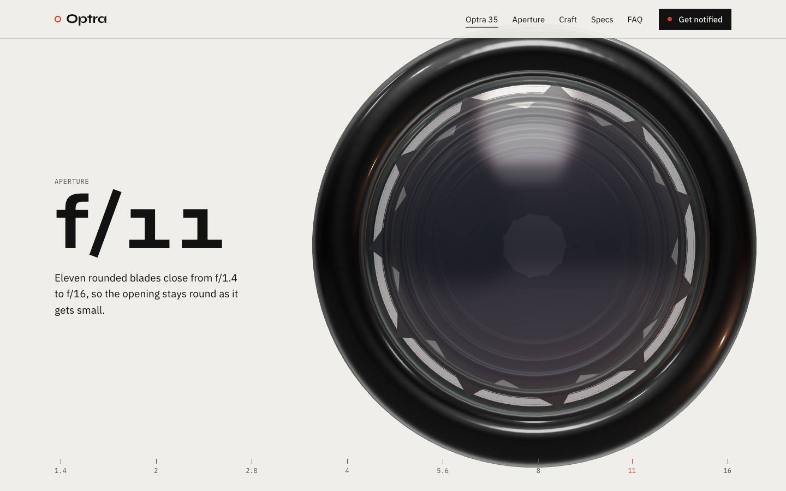](https://bibeksarkar001.github.io/3d-website-factory/optra/) |
| **Ridgeline.** An e-MTB tour: motor, battery, fork and tyres, then drag it round and tap its parts. [Live demo →](https://bibeksarkar001.github.io/3d-website-factory/ridgeline/) | **Optra.** A camera lens. Its eleven aperture blades close as you scroll, then the glass comes apart. [Live demo →](https://bibeksarkar001.github.io/3d-website-factory/optra/) |

Every 3D object above is built in code: no video, no paid assets, sharp at any size, and it reacts to the visitor.
All twelve brands are fictional. [All demos →](https://bibeksarkar001.github.io/3d-website-factory/)

## What it does

You put your words, logo and pictures in a folder and say **"build me this as a website"**. A five-role pipeline
does the rest:

```
           ┌──> Sculptor ── makes the 3D objects ──┐
Scout ─────┤                                       ├──> Builder ── stitches the site ──> Critic ──┐
interview, └──> Animator ── makes the motion ──────┘       ^                                       │
design system,                                             └───────── fixes, at most 3 rounds ─────┘
hero concepts
```

| Role | Job |
|---|---|
| **Scout** | Interviews you in multiple choice (vibe, what the visitor must believe, journey, real vs generated assets, the signature move). Finds three reference sites, you pick one. Writes the design system. Proposes three hero concepts, you pick one. |
| **Sculptor** | Makes each 3D object: your logo extruded, your product rebuilt from shapes, your `.glb` model, a model generated from a photo, or a Spline scene. Exploded views, feature tours, free rotation with hotspots. |
| **Animator** | Studio-style motion: scroll-driven moments you control, looping explainers, count-ups, maps that fill, drawing lines, the product's own action you can do yourself. One rhythm, sensible pacing. |
| **Builder** | Stitches it all into one site on your design system, wires the interactions you asked for ("follow the cursor", "spin when I scroll"), edits the copy and shows you every change. |
| **Critic** | Screenshots the whole scroll journey and judges it against fourteen fixed questions. Sends fixes back until it passes. |

The roles hand over through files, so any part can be redone alone: "make the logo glossier" only reruns the sculptor.
If your agent can run sub-agents, each role gets its own; otherwise one agent plays them in order.

**Already have a website?** Run it inside your project and say **"make my website 3D"**. It reads your stack
(plain HTML, React, Next, Vue, Svelte, Astro, WordPress), proposes what goes where, waits for your yes, and changes
as few files as possible on a new branch. Your design and words stay yours.

## Install

**Claude Code** (plugin):
```
/plugin marketplace add bibeksarkar001/3d-website-factory
/plugin install 3d-website-factory@3d-website-factory
```

**Cursor, Codex, Antigravity, Hermes, Claude Code and 40+ other agents** (skill):
```sh
npx skills add bibeksarkar001/3d-website-factory -g
```

**Or by hand:** copy `skills/3d-website-factory/` into your agent's skills folder
(for Claude Code: `~/.claude/skills/3d-website-factory`).

Needs Chrome, Python 3 and Node 22+. Films also need ffmpeg.

## Use

Open your agent in any folder and say:

| Say | What happens |
|---|---|
| "Set up the website factory" | Makes a `website-factory/` folder: `content/`, `assets/logo/`, `assets/images/`, `assets/models/`, `assets/style/`, `sites/` |
| "Build me this as a website" | Builds a site for every file in `content/`. The result is a plain folder in `sites/<name>/` you can host anywhere. |
| "Make my existing website 3D" | Inside your own project. Proposes first, changes little, never pushes. |
| "Make the logo follow the cursor" | Changes a built site. Only the role that owns it reruns. |
| "Add a scroll film" | Adds a photoreal, scroll-scrubbed film section. |
| "Publish it" | Deploys through a connected host (Hostinger, Netlify, Vercel, GitHub Pages), only when you ask. |

## What it costs

Code-built 3D, Spline community scenes and all motion are **free**. Optional paid extras (AI images, AI video,
3D models generated from a photo) go through Higgsfield or any generator you connect. The agent **quotes the
credits and shows your balance before every paid step**, makes stills before clips and offers one-of-three
choices. There is also a free manual route: it writes the prompts, you generate in a free tool like Google Flow,
drop the files in, and it carries on.

Optional connections:
```sh
npm install -g @higgsfield/cli && higgsfield auth login                        # AI images, video, image-to-3D
claude mcp add --transport http spline https://mcp.spline.design/mcp -s user   # build Spline scenes
```

## Quality built in

- **No AI slop.** A ban list of generated-looking tells (purple gradients, three feature cards, eyebrow labels,
  reflex cream backgrounds, overused fonts) and of generated-sounding words.
- **Facts only.** Never invents numbers, prices, customers, quotes or logos.
- **Checked like a human would.** `probe.mjs` loads the page in headless Chrome, waits for the 3D, scrolls with
  the mouse over every 3D object, checks the phone layout and the console, and saves a contact sheet of the whole
  scroll journey for the critic.
- **Accessible.** Reduced motion gets a finished still page. Contrast checked. Alt text everywhere.

## Inside

| Path | What |
|---|---|
| `skills/3d-website-factory/SKILL.md` | The conductor: jobs, pipeline, gates, rules |
| `skills/3d-website-factory/roles/` | Scout, sculptor, animator, builder, critic |
| `skills/3d-website-factory/references/` | Taste and slop list, motion patterns, asset routes and providers, film method |
| `skills/3d-website-factory/runtime/` | `stage.js` (three.js stage: studio light, cursor, scroll, logo extrude, model loader), `factory.js` (reveals, loops, scroll scrub, lazy Spline, film), `factory.css` |
| `skills/3d-website-factory/scripts/` | `init.sh` (workspace), `check.py` (page gate), `probe.mjs` (browser test and journey sheet), `browser.sh` |
| `docs/` | The live demos |

## Licence

MIT. See `LICENSE`.
